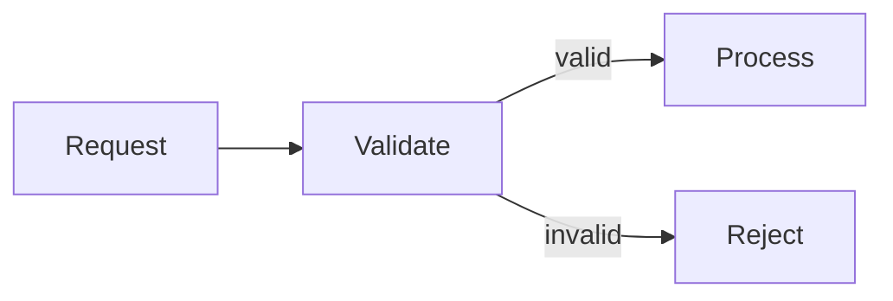

# Diagram

Interactive [Mermaid](https://mermaid.js.org/) diagrams and [Apache ECharts](https://echarts.apache.org/) charts beside VS Code chat. Ask your chat agent to draw, select items in the panel, edit the source and ask follow-up questions about what you selected. Choose the **Diagram** agent for a conversation focused on diagrams and charts.

Requires VS Code 1.143 or later. Chat features need an agent that supports extension tools, such as GitHub Copilot. Diagrams in Markdown files open and edit without chat.

## Install

Install [Diagram from the Visual Studio Marketplace](https://marketplace.visualstudio.com/items?itemName=fornwall.diagram-chat), or run:

```sh
code --install-extension fornwall.diagram-chat
```

To build from source, see [CONTRIBUTING.md](CONTRIBUTING.md).

## Get started

Open VS Code's Chat view and enable Diagram tools under **Chat: Open Customizations → Tools** (or **Configure Tools** in Local chat). Try:

```text
Draw a flowchart in the diagram panel: request → validate → process; reject invalid requests
```

Select a node in the panel, type “What could go wrong at this step?” in its message field, and press **Send to chat**. The request includes your selection and continues in chat.

For a focused session, select **Diagram** from the chat agent dropdown. It uses the same tools and panel, with instructions for drawing, checking and explaining diagrams. Both entry points come with the extension.

You can also attach files with `#file` or images, or chart a command's output:
- `sequence diagram of the OAuth login flow in #file:src/auth.ts`
- `bar chart of commits per author from git shortlog -sn HEAD`
- `treemap of du -ah src`
- `histogram of request latency in #file:requests.csv, one panel per service`
- `turn this whiteboard photo into a flowchart`

Ask to change the current diagram, start a new one, or explain it without changes. **Diagram: Show Panel** reopens the panel. Tools return render errors and layout warnings so the agent can repair them.

If you used earlier versions, choose **Diagram** or use ordinary agent chat in place of the retired `@diagram` participant and its slash commands.

## The panel

- **Select** nodes, edges, sequence messages or chart items by clicking; Ctrl/Cmd+click or Shift+click adds to the selection. For keyboard selection, Tab to the drawing, move with the arrow keys and press Enter or Space.
- **Ask**: type a question or change and press **Send to chat**. The request includes your selection.
- **Edit** the source in split view and press **Apply** (Ctrl/Cmd+Enter). The agent can read your applied edits through the diagram state tool.
- Right-click for **Highlight Path** when two selected nodes have a path between them in a flowchart or state diagram, **Clear Selection** to remove selections and agent highlights, or **Help** for a brief guide.
- **Find** text with Ctrl/Cmd+F, **zoom and pan** Mermaid diagrams, and open nodes linked to files or URLs.
- **Chart Options** (the gear in the title bar) reconfigures a chart made from data; **Refresh** reloads its file or command.
- **Export** PNG, SVG or an HTML page with embedded source and data (viewing HTML requires internet access), or drag the picture handle into another app.

Diagrams follow your VS Code theme, high contrast included. Agents can mark items, for example to walk you through a diagram, and can ask you to pick items as an answer.

## Diagrams in Markdown

To try the panel without chat, paste this into a Markdown file:

````markdown

````

Click **Open in Diagram** above the block, or run **Diagram: Open Diagram at Cursor**. Both `mermaid` and `echarts` blocks are supported. **Apply** renders your edits and writes them back to the block as an unsaved, undoable change, keeping the surrounding text. Changes made by an agent need your confirmation before they are written. Set `diagram.codeLens.enabled` to `false` to hide the links above blocks.

## Charts from data

Diagram can chart inline data, a file or a command's output. It reads CSV, TSV, JSON, JSON Lines, Markdown tables and common terminal tables, including sizes such as `20 MiB` and durations such as `1h2m3s`.

Charts can filter, aggregate, sort and limit rows, and split into a panel per value of a column. See [chart data](docs/reference.md#chart-data) for formats, chart types and settings. For custom charts, the model can write an ECharts option directly.

## Chat tools

The Diagram agent and ordinary chat conversations use the same tools. Reference `#diagram`, `#diagramEdit`, `#chart`, `#diagramState`, `#diagramImage` or `#diagramPick` in chat. Tools support source search, paged data inspection and revision checks that protect newer edits. `#diagramExport` saves a named HTML file with embedded source and data; opening it requires internet access.

See [the tools reference](docs/tools.md) for details. Agents can read `diagram_guide` with `{"topic":"workflow"}` for tool selection and verification.

## Security

VS Code asks before running a command, reading a data file outside the workspace or exporting HTML through a tool. File links outside the workspace require confirmation; website links follow VS Code's trusted-domain settings. Commands and ECharts options with JavaScript need a trusted workspace; in an untrusted workspace, reading workspace files also asks first. The panel loads no remote content; exported HTML files load their renderer from a CDN when opened.

Chat sends your prompt, attachments and tool results, including diagram context read by the agent, to the model selected in VS Code. Opening and editing a Markdown diagram does not require a model.

## Limits

Data files and command output are limited to 10 MiB, commands to 60 seconds, tables to 1,000,000 cells and Mermaid sources to 50,000 characters. Summarize larger datasets before charting them.

See [the full reference](docs/reference.md) for everything the panel, Markdown editing and chart data support, and for all limits.

## Feedback

Report issues and contribute on [GitHub](https://github.com/fornwall/diagram). See [CONTRIBUTING.md](CONTRIBUTING.md) to build and test the extension.

Licensed under [Apache-2.0](LICENSE).
